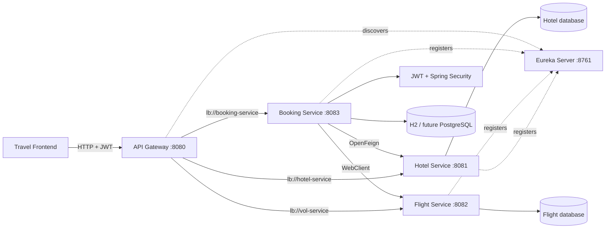
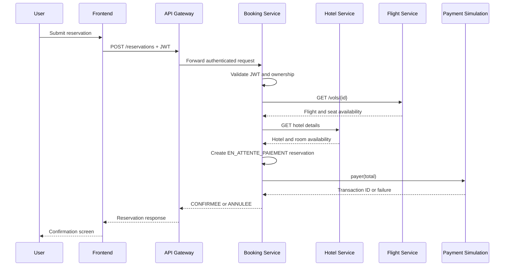

# Travel Booking System

### A scalable Spring Cloud platform for hotels, flights, authentication, reservations, and payments

[](https://www.oracle.com/java/technologies/javase/jdk21-archive-downloads.html)
[](https://spring.io/projects/spring-boot)
[](https://spring.io/projects/spring-cloud)
[](https://maven.apache.org/)
[](https://jwt.io/)
[](https://spring.io/projects/spring-cloud-netflix)

> A domain-driven travel booking backend where independently deployable Spring Boot services collaborate through service discovery and a centralized API gateway.

## Product overview

This platform supports the core workflow of a travel booking application:

```text
Discover hotels and flights
          |
          v
Authenticate the traveler
          |
          v
Check availability
          |
          v
Create a reservation
          |
          v
Process payment
          |
          v
Confirm or cancel the booking
```

The system is intentionally split into business-focused microservices so the platform can grow without turning into one tightly coupled application.

## Connected frontend

The companion frontend is available here:

**[TravelBookingSystem_FrontEnd](https://github.com/Oussamoux1234/TravelBookingSystem_FrontEnd)**

The frontend communicates with the API Gateway rather than calling internal services directly:

```text
Frontend
   |
   | HTTP + Authorization: Bearer <JWT>
   v
API Gateway :8080
   |
   +--> Hotel Service :8081
   +--> Flight Service :8082
   `--> Booking Service :8083
            |
            +--> H2 development database
            +--> JWT security
            +--> Hotel Service through OpenFeign
            `--> Flight Service through WebClient
```

## Microservices architecture

```text
                                      +------------------+
                                      | Frontend client  |
                                      +--------+---------+
                                               |
                                               v
                                      +------------------+
                                      | API Gateway      |
                                      | localhost:8080   |
                                      +--------+---------+
                                               |
                         +---------------------+----------------------+
                         |                     |                      |
                         v                     v                      v
                 /hotels/**              /vols/**             /reservations/**
                         |                     |                      |
                         v                     v                      v
                 +---------------+     +---------------+     +----------------+
                 | hotel-service  |     | vol-service   |     | booking-service|
                 | catalog        |     | flights       |     | auth + booking |
                 +-------+-------+     +-------+-------+     +--------+-------+
                         |                     |                       |
                         v                     v                       +--> H2 / future DB
                 +---------------+     +---------------+               +--> JWT filter
                 | hotels/rooms  |     | flights/seats |               +--> payment service
                 +---------------+     +---------------+

                                      +------------------+
                                      | Eureka Server    |
                                      | localhost:8761   |
                                      +------------------+
```

## Service responsibilities

| Service | Responsibility | Current implementation |
|---|---|---|
| `api-gateway` | Public entry point and request routing | Spring Cloud Gateway on `8080` |
| `eureka-server` | Service registry and discovery | Eureka server on `8761` |
| `hotel-service` | Hotels, rooms, prices, availability | Spring Boot, JPA, H2, seed data |
| `vol-service` | Flights, schedules, prices, seats | Spring Boot, JPA, H2, seed data |
| `booking-service` | Users, JWT auth, reservations, payment flow | Spring Security, JPA, H2, OpenFeign, WebClient |

## How service discovery works

The Eureka server is the registry for the platform:

```text
hotel-service   --registers--> Eureka
vol-service     --registers--> Eureka
booking-service --registers--> Eureka
api-gateway     --discovers--> Eureka
```

The gateway routes using logical service names such as:

```yaml
uri: lb://hotel-service
```

The booking service also uses discovery-aware clients:

```java
@FeignClient(name = "HOTEL-SERVICE")
```

and:

```text
http://VOL-SERVICE
```

This avoids hard-coding internal IP addresses and enables multiple instances of the same service.

## End-to-end request flows

### Hotel details and availability

```text
GET /hotels/{id}
        |
        v
API Gateway
        |
        v
HotelController.getHotelDetails()
        |
        v
HotelRepository.findById()
        |
        v
Hotel + rooms returned as JSON
```

Availability:

```text
GET /hotels/{id}/disponibilite/{type}
        |
        v
Load hotel
        |
        v
Search its rooms
        |
        +--> matching room type
        +--> disponible = true
        |
        v
Return true or false
```

### Authentication

```text
POST /auth/register
        |
        v
Validate request
        |
        v
Check duplicate email
        |
        v
BCrypt password hashing
        |
        v
Save User
        |
        v
Generate JWT
        |
        v
Return AuthResponse
```

```text
POST /auth/login
        |
        v
AuthenticationManager
        |
        v
UserDetailsService + UserRepository
        |
        v
Verify BCrypt password
        |
        v
JwtService.generateToken()
        |
        v
Return JWT + user information
```

### Authenticated request

```text
Request with Authorization: Bearer <JWT>
        |
        v
JwtAuthenticationFilter
        |
        +--> Extract token
        +--> Extract email
        +--> Load User
        +--> Validate signature and expiration
        `--> Populate SecurityContext
```

The reservation routes then use the authenticated user from the security context.

### Reservation creation

```text
POST /reservations
        |
        v
BookingController.creerReservation()
        |
        +--> Read current authenticated User
        |
        +--> If volId exists:
        |       WebClient -> VOL-SERVICE /vols/{id}
        |       Check placesDisponibles
        |       Add flight price
        |
        +--> If hotelId exists:
        |       OpenFeign -> HOTEL-SERVICE /hotels/{id}
        |       OpenFeign -> availability endpoint
        |       Add hotel price per night
        |
        +--> Reject if no valid item is available
        +--> Build Reservation
        +--> Set owner and booking details
        +--> Save with EN_ATTENTE_PAIEMENT
        |
        +--> PaiementService.payer(total)
        |       |
        |       +--> success: transaction ID + CONFIRMEE
        |       `--> failure: ANNULEE
        |
        `--> Return reservation response
```

## Domain models

### Hotel domain

```text
Hotel
  ├── id
  ├── nom
  ├── adresse
  ├── ville
  └── chambres: List<Chambre>

Chambre
  ├── id
  ├── numero
  ├── type: SIMPLE | DOUBLE | SUITE
  ├── prixParNuit
  ├── disponible
  └── hotel
```

### Flight domain

```text
Vol
  ├── id
  ├── numeroVol
  ├── aeroportDepart
  ├── aeroportArrivee
  ├── heureDepart
  ├── dateHeureDepart
  ├── prix
  └── placesDisponibles
```

### Reservation domain

```text
Reservation
  ├── id
  ├── dateReservation
  ├── clientEmail
  ├── statutReservation
  ├── volId
  ├── hotelId
  ├── montantTotal
  ├── transactionPaiementId
  ├── passengerName
  ├── typeChambre
  ├── seatNumber
  ├── flightClass
  ├── checkInDate
  ├── checkOutDate
  └── user ownership
```

## API surface

### Gateway routes

| Method | Endpoint | Access | Description |
|---|---|---:|---|
| `GET` | `/hotels/{id}` | Public | Get hotel details |
| `GET` | `/hotels/{id}/disponibilite/{type}` | Public | Check room availability |
| `GET` | `/vols/**` | Public | Access flight operations |
| `POST` | `/auth/register` | Public | Register a user |
| `POST` | `/auth/login` | Public | Authenticate a user |
| `GET` | `/auth/me` | Authenticated | Get current user |
| `GET` | `/reservations` | Authenticated | Booking-service health response |
| `GET` | `/reservations/my` | Authenticated | List current user's reservations |
| `GET` | `/reservations/{id}` | Authenticated | Get owned reservation |
| `POST` | `/reservations` | Authenticated | Create reservation and process payment |

## Development data

The platform currently seeds development data at startup.

### Hotels

`HotelDataInitializer` creates ten sample hotels and rooms across locations including:

- Chamonix;
- New York;
- Nice;
- Paris;
- Manaus;
- Marrakech;
- Maldives;
- Edinburgh;
- Kyoto;
- Zermatt.

### Flights

`VolDataInitializer` creates ten sample flights including:

- Paris to New York;
- Tokyo to Seoul;
- London to Singapore;
- Dubai to Paris;
- Miami to Cancun;
- Amsterdam to Barcelona;
- Sydney to Auckland;
- Istanbul to Rome;
- Los Angeles to Honolulu;
- Frankfurt to Cape Town.

These are startup fixtures for local development, not production inventory.

## Security model

The booking service uses:

- stateless Spring Security sessions;
- BCrypt password encoding;
- JWT access tokens;
- a custom `JwtAuthenticationFilter`;
- `AuthenticationManager` and `DaoAuthenticationProvider`;
- ownership checks for reservation reads;
- public catalog routes and protected reservation routes.

### Public routes

- `/auth/**`;
- `/hotels/**`;
- `/vols/**`;
- `/h2-console/**`;
- `/actuator/**`;
- `OPTIONS` preflight requests.

### Protected routes

- `/reservations/**`;
- all non-public routes.

> The JWT secret is currently defined in development YAML. Production deployments must load it from a secret manager or environment variable.

## Payment behavior

Payment is currently simulated by `PaiementService`:

```text
amount > 0
    -> generate TXN-{timestamp}
    -> set reservation to CONFIRMEE

amount <= 0 or payment exception
    -> set reservation to ANNULEE
```

A future payment service should add a real provider, idempotency, secure callbacks, reconciliation, and retry handling.

## Scalability design

### Current scalability foundation

- independent Spring Boot services;
- centralized gateway entry point;
- Eureka service discovery;
- logical load-balanced service names;
- domain-specific data ownership;
- service-to-service clients through Feign and WebClient;
- Actuator support for health and monitoring;
- Maven multi-module build.

### Horizontal scaling

```text
                         +--> hotel-service instance 1
API Gateway + Eureka ----+--> hotel-service instance 2
                         `--> hotel-service instance 3
```

The same model can be used for booking and flight traffic. The frontend remains unchanged because it calls the gateway, not individual instances.

### Recommended production evolution

1. Replace H2 with PostgreSQL or MySQL.
2. Use a database per service.
3. Add Flyway or Liquibase migrations.
4. Externalize all secrets and service configuration.
5. Add Docker and Docker Compose.
6. Add Kubernetes deployments and health probes.
7. Add Resilience4j circuit breakers and timeouts.
8. Add Redis caching for hotel and flight searches.
9. Add Kafka or RabbitMQ for asynchronous booking events.
10. Add Prometheus, Grafana, and OpenTelemetry.
11. Add centralized logging.
12. Add API rate limiting.
13. Add pagination and search filters.
14. Add contract and integration tests.
15. Make seed data conditional by profile.

## Visual architecture test

The following Mermaid diagram can be rendered by GitHub to provide a visual system test of the runtime architecture:



### Visual booking test



## Configuration and ports

| Component | Port | Configuration |
|---|---:|---|
| Eureka Server | `8761` | `eureka-server/src/main/resources/application.yml` |
| API Gateway | `8080` | `api-gateway/src/main/resources/application.yml` |
| Hotel Service | `8081` | module application configuration |
| Flight Service | `8082` | module application configuration |
| Booking Service | `8083` | `booking-service/src/main/resources/application.yml` |

Booking development configuration uses:

```yaml
spring:
  datasource:
    url: jdbc:h2:mem:bookingdb
  jpa:
    hibernate:
      ddl-auto: create-drop
```

## Build and run

### Prerequisites

- Java 21+;
- Maven 3.9+ or Maven Wrapper;
- Git.

### Clone and build

```bash
git clone https://github.com/Oussamoux1234/TravelBookingSystem.git
cd TravelBookingSystem
./mvnw clean install
```

Windows:

```powershell
mvnw.cmd clean install
```

### Start services

Start each command in a separate terminal:

```bash
./mvnw -pl eureka-server spring-boot:run
./mvnw -pl hotel-service spring-boot:run
./mvnw -pl vol-service spring-boot:run
./mvnw -pl booking-service spring-boot:run
./mvnw -pl api-gateway spring-boot:run
```

Recommended order:

```text
1. Eureka Server
2. Hotel Service
3. Flight Service
4. Booking Service
5. API Gateway
6. Frontend
```

## Testing strategy

The repository includes Spring Boot test scaffolds for the modules. Recommended validation commands:

```bash
./mvnw test
./mvnw verify
```

Important test layers to add or expand:

- unit tests for JWT creation and expiration;
- authentication controller tests;
- hotel availability tests;
- booking ownership tests;
- reservation status transition tests;
- gateway route tests;
- Eureka registration tests;
- Feign and WebClient integration tests;
- payment failure tests;
- full end-to-end booking flow tests.

## Current limitations

- H2 databases are in-memory and reset on restart.
- Payment is simulated.
- Hotel and flight seed data are inserted at startup.
- JWT secret is present in development configuration.
- The catalog API has limited filtering and pagination.
- Service resilience policies are not yet implemented.
- Production observability and deployment manifests are not yet included.

## License

No open-source license is currently declared. Add a `LICENSE` file before public distribution or commercial use.

## Related project

[TravelBookingSystem Frontend](https://github.com/Oussamoux1234/TravelBookingSystem_FrontEnd)

## Contributors

- Oussamoux1234
